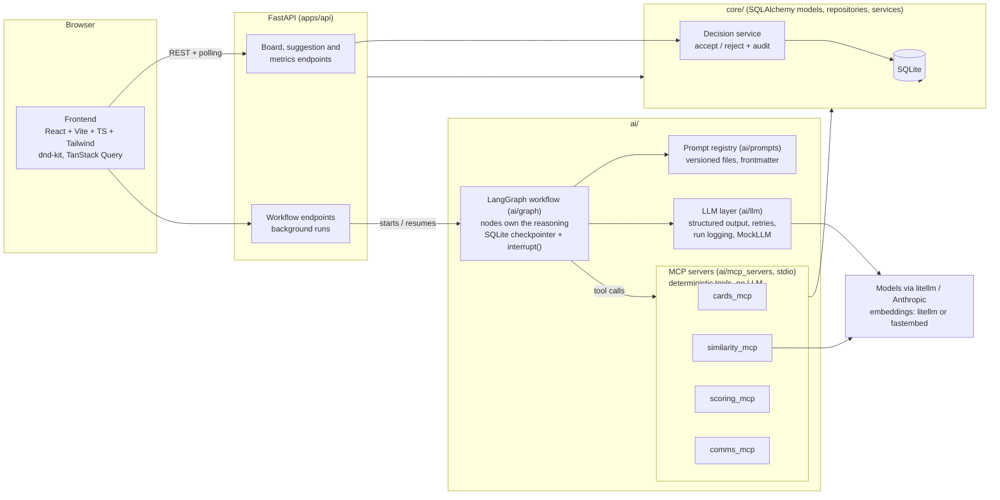

# Feature Request Board with AI triage

A Kanban board for product feature requests, with an AI workflow that does the tedious part of triage (spotting duplicates, grouping requests by the underlying problem, scoring, tagging, drafting a brief) and then **stops and asks a person** before anything is changed.

## The problem, and who it helps

Feature requests pile up in many words: three customers ask for "SAML", "Okta login" and "Azure sign-in", and nobody notices they are the same need. Product managers spend hours reading, searching for duplicates, scoring against a rubric and writing up. Votes are split across duplicates, so popularity misleads, and scoring varies from person to person.

- **Product managers** get a first pass on every request, with the AI's reasoning and confidence, and decide with one click.
- **Customer success and sales** see which requests are already known, and get a drafted reply for the requester.
- **Engineering and leadership** get consolidated demand (votes merged onto one card) and consistent scores from one rubric.

## Features

- **Board:** multiple boards, status columns, drag and drop (mouse and keyboard) with optimistic updates and rollback, colored tags, votes, progress, comments, customer feedback quotes, search, tag filter, a **Needs review** filter.
- **Card drawer:** edit everything (with conflict detection if someone else changed the card), plus a **Grouping** section (underlying problem, duplicates, related requests).
- **AI triage** (full run or any single step): validate intake, analyze the underlying need, find duplicate and related requests, group by problem, score against a configurable rubric, suggest tags, write a decision brief, draft a message to the requester.
- **AI Suggestions panel:** every finding appears with its confidence and reasoning, and can be accepted, edited or rejected. Scores can be overridden (a reason is required).
- **Merge duplicates:** accepting a duplicate moves its votes to the primary card and keeps the two linked.
- **Audit trail and metrics page:** every decision is recorded; the metrics page is computed from it.
- **Runs without any model:** `MOCK_AI=1` gives deterministic output, so the whole system works offline.

## Architecture



Dependency rule: `apps/api` and `ai/*` may import `core`; `core` imports nothing from either; MCP servers never call the FastAPI app. LangGraph **nodes contain the reasoning and the prompts**; MCP servers expose **deterministic capabilities only** (data access, similarity search, score maths, storing drafts). The model is never given tools: nodes call tools themselves, and the model only returns validated JSON.

| Folder | What is there |
|---|---|
| `apps/web` | React frontend |
| `apps/api` | FastAPI routers, schemas, the workflow runtime |
| `core/` | models, repositories, services (decisions, scoring, metrics) |
| `ai/graph` | the LangGraph workflow, `Workflow` class, CLI |
| `ai/mcp_servers` | the four MCP servers and the client that starts them |
| `ai/prompts`, `ai/llm` | prompt files and registry; model factory, schemas, mock, run logging |
| `ai/evals` | evaluation against labelled seed data |
| `config/` | scoring rubric and message templates (YAML) |
| `docs/` | `ARCHITECTURE.md`, `DECISIONS.md`, `PLAN.md`, `EVAL_RESULTS.md` |

## Setup (everything runs in Docker; you need Docker and `make`)

```bash
git clone <this repo> && cd mectacto
make setup      # creates .env (MOCK_AI=1 by default) and builds the images
make seed       # creates the database with 2 boards and 30 demo requests
make demo       # optional: sample AI decisions so the Metrics page has data
make dev        # starts the API and the web app
```

Open <http://localhost:5173> (API docs at <http://localhost:8000/docs>). Try it: click **New card**, enter a request that repeats a seeded one (for example title "Support SAML single sign-on please" with the same description as the existing SAML card), open it and click **Run AI triage**, then accept the merge suggestion.

Other commands: `make test` (backend and frontend), `make lint`, `make e2e` (browser test in an isolated stack), `make eval`, `make graph ARGS="--card-id 1 --steps analyze,score"` (run the workflow from the command line), `make mcp-tools` (list the MCP tools), `make help`.

## Running with MOCK_AI or a real model

**Mock mode (default).** `MOCK_AI=1` in `.env`. No key, no network, deterministic output: a rule-based stand-in for the model and a hashed bag-of-words for embeddings. It exists so the whole system runs anywhere and is testable. It is a wiring test, not a quality test: it only finds duplicates that share most of their words.

**Real models via litellm (what the app is configured for).** Set `MOCK_AI=0` and point `LITELLM_BASE_URL` / `LITELLM_API_KEY` at your litellm proxy. The default setup talks OpenAI format to local models behind it (the active prompt version uses `llama3.2:3b`; embeddings use `nomic-embed-text-v2-moe`).

**Real models with an `ANTHROPIC_API_KEY`.** In `.env`:

```bash
MOCK_AI=0
LLM_PROVIDER=anthropic
ANTHROPIC_API_KEY=sk-ant-...
LITELLM_BASE_URL=            # leave empty so nothing is routed to a proxy
EMBEDDING_PROVIDER=fastembed # local ONNX model (downloaded on first use, about 130 MB); no second key
```

and use the Claude version of the prompts: either set `active: 1` for each prompt in `ai/prompts/registry.yaml` (version 1 names Claude models), or set `AI_MODEL_OVERRIDE` to a model name. Then `docker compose up -d --build api`. **Not yet run against the live Anthropic API** (no key was available while building); the path is covered by tests with a fake chat model, so expect to check it with a real call first. The `OpenAI`/litellm path was run live.

## Prompt management

- Every prompt is a file: `ai/prompts/<name>/vN.md` with YAML frontmatter (name, version, model, temperature, input variables, output schema) and a Jinja2 body split into system and user sections. Nothing is written inline in code.
- `ai/prompts/registry.yaml` says which version of each prompt is active. The loader validates the frontmatter, the template and the variables, and renders the messages.
- **Released versions are immutable.** `make freeze-prompts` stores a hash of each version; editing a released file makes the loader refuse it. To change a prompt, add `vN+1` and switch `active`. (v2 exists only because switching to local models changed the `model` line.)
- **User text is data.** Variables marked untrusted are wrapped by the loader in `<user_data>` blocks the model is told never to obey, and a block cannot be closed from inside. Templates cannot put untrusted text in the system message; the loader rejects that.
- Every output is a Pydantic schema (with `confidence` and `rationale`); a malformed answer gets one repair attempt. Every model call is logged with prompt name and version, model, input hash, output, confidence, latency and tokens.

## Human-in-the-loop points

1. **Nothing the AI produces is applied.** It becomes a suggestion; the MCP tools that write can only create suggestions or drafts, and there is no tool that applies one.
2. **Accept / edit / reject** each suggestion in the drawer. Accepting is the only thing that changes the board, and it writes an audit entry in the same transaction. Overriding a score needs a reason.
3. **The workflow pauses and asks** when it is not sure: a duplicate it is only moderately confident about, or an analysis it is unsure is actionable. State is saved to SQLite, so the question can wait and be answered later, even after a restart. A confident duplicate becomes a merge *proposal*, still a suggestion.
4. **Vague requests** are not scored; the workflow drafts questions for the requester instead.
5. **Rejections stick:** a rejected duplicate or problem is not proposed again.
6. **Messages are never sent.** Approving a draft only marks it approved.

## Success metrics

Shown on the **Metrics** page and at `GET /api/metrics`, computed from the audit log (each shows its definition and counts; "no data yet" rather than zero):

1. **Time to first decision:** minutes from a card's creation to the first human accept, reject or override of an AI suggestion on it.
2. **Suggestion acceptance rate** (with and without edits, by type), plus **duplicates consolidated** (and votes moved).
3. **Score override rate:** of the scores people accepted, how many they changed.

The manual baseline (15 minutes of work per card) is an **assumption**, labelled as such and configurable; it is not like for like with elapsed time, so the page does not subtract one from the other. `make demo` adds clearly flagged sample data.

Quality is measured separately with `make eval`, which scores duplicate and related detection against labelled seed data (`docs/EVAL_RESULTS.md`). On the configured local models, similarity search finds every labelled pair, but the 3B judge is too unsure: duplicate precision 1.00, recall 0.43, and no pair reaches the confidence needed for an automatic merge proposal.

## Risks and tradeoffs

- **Prompt injection.** Reduced (delimiters, schema validation, no tools for the model, human approval), not eliminated; a model can still be swayed into a misleading rationale or an inflated confidence.
- **Hallucinated merges.** A merge needs similarity *and* a judge verdict, is only ever a suggestion, and moves votes only when a person accepts. There is no undo button; the audit entry records the moved voters.
- **Model quality on small local models.** Only duplicate judging has been measured (see above). Scoring, tags, briefs and drafts are unmeasured, and scores vary between models.
- **Cost and latency.** A full run is 10 to 25 model calls (about 20 s on a local 3B model). Limits: a per-run call budget, capped candidates and input length, one active run per card, a cap on concurrent runs. There is no per-user or daily budget.
- **No authentication.** `X-User-Id` is self-declared. Put real auth, rate limiting and TLS in front before exposing it.
- **SQLite and one API process.** Simple and enough for a team; two API workers would each start their own MCP servers and the one-run-per-card guard is in-process.
- **Scoring consistency.** The model only rates criteria 1 to 5 on anchored scales; weights and totals are computed in code, and each score stores the rubric version it used.
- **Metrics measure agreement, not correctness.** High acceptance can mean trust or habit.
- **Choices made:** drag and drop saves immediately (with rollback) while drawer edits wait for Save; the older card survives a merge and the duplicate card is kept; the model is never given tools, at the cost of a less flexible "agent".

The full list of limitations is in [docs/DECISIONS.md](docs/DECISIONS.md).

## Next steps

- **A better duplicate judge:** try a stronger model or calibrate confidences; the eval shows exactly where the 3B model falls short. Add `v3` of `group_problem` (the 3B model sometimes copies the id from the prompt's example).
- **Evaluate the other prompts** (scoring, tags, briefs, drafts) with labelled data and a held-out split.
- **Authentication and per-user budgets,** then multi-user comments and permissions.
- **Run against the live Anthropic API** and record it in the eval results.
- **An undo for merges,** and real delivery for approved drafts (email or Slack).
- **Scale:** Postgres with a vector index instead of SQLite and in-memory search; checkpoint cleanup.
- **Bake the embedding model into the image** and add a production build (`docker/web.Dockerfile` has dev only today).

More detail: [docs/ARCHITECTURE.md](docs/ARCHITECTURE.md), [docs/DECISIONS.md](docs/DECISIONS.md), [docs/PLAN.md](docs/PLAN.md), [docs/EVAL_RESULTS.md](docs/EVAL_RESULTS.md).
